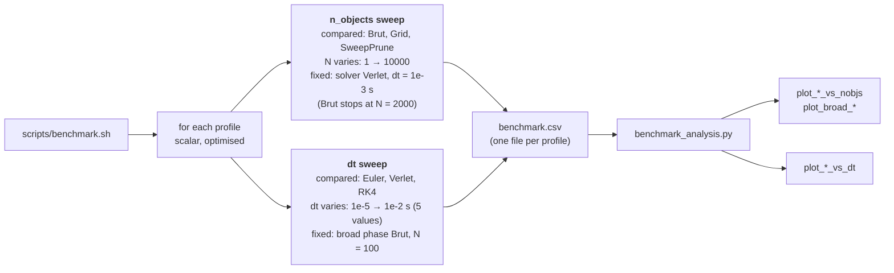

# Performance Benchmark Binary

`benchmark.cpp` builds `benchmarks/Performance`, the binary every benchmark and profiling
script measures. This page is its reference (scene, options, CSV columns) and lists how to
install the profiling tools. For how to run the benchmarks and read the results, see
[`BENCHMARK_TOOLS_GUIDE.md`](BENCHMARK_TOOLS_GUIDE.md).

## Scene

| Parameter | Value |
|---|---|
| Dynamic objects | N spheres (`--n_objects`, mass 1, restitution 1), diameters uniform in [1, 8], placed at random without overlap in a cube sized for a 10% volume fraction, velocities uniform in [-5, 5] m/s per axis |
| Randomness | Fixed seed: every run, solver and broad phase sees the same scene for a given N |
| Static objects | None: the scene measures the broad phase, and a large plane would dictate the grid cell size |
| Collisions | Impulse model by default; spring-damper contact forces with `--contact-forces` |
| Gravity | Default engine gravity |

The cube grows with N, so the collision rate stays constant. The spread of diameters exposes the
grid's weakness (cells sized on the largest object). The scene is rebuilt before every run.

## Run structure

```
[ warm-up runs (discarded) ] [ timed runs (recorded) ] [ one step-timing run ]
```

- **Warm-up runs** (`--n_warmup`): the CPU reaches a steady clock and the caches warm up.
- **Timed runs** (`--n_runs`): each full run of `dur / dt` steps is timed; the statistics below
  come from these.
- **Step-timing run**: one more run, timed in ~500 batches of steps (nanosecond clock), to
  measure how regular the cost of a step is.

## Sweeps run by `scripts/benchmark.sh`

The script calls this binary over two independent sweeps, for each build profile. Each sweep
compares one thing and fixes everything else: the n_objects sweep compares the broad phases
(one solver), the dt sweep compares the solvers (one broad phase).



| | n_objects sweep | dt sweep |
|---|---|---|
| Compared | Broad phases: Brut, Grid, SweepPrune | Solvers: Euler, Verlet, RK4 |
| Varies | N ∈ {1, 2, 5, 10, 20, 50, 100, 200, 500, 1000, 2000, 5000, 10000} | dt: 5 values log-spaced in [1e-5, 1e-2] s |
| Fixed | Solver Verlet, dt = 1e-3 s | Broad phase Brut, N = 100 |
| Question answered | How does each broad phase scale with N? | How does each solver's step cost behave with dt? |
| Options | `--broads`, `--n-solver`, `--n-objects`, `--dt`, `--brut-n-max` | `--solvers`, `--dt-broad`, `--n-fixed`, `--dt-min`, `--dt-max`, `--dt-n` |
| Figures | `plot_*_vs_nobjs`, `plot_broad_*` | `plot_*_vs_dt` |

Both sweeps simulate `--dur` = 1 s per point. The point they share (Verlet, Brut, N = 100,
dt = 1e-3) is measured only once. Brut is the dt sweep's broad phase because its cost does not
depend on where the objects are. In the n_objects sweep, Brut is skipped above `--brut-n-max`
(default 2000) because its O(N²) cost makes N = 5000 and above take hours.

## Command-line options

| Flag | Default | Description |
|---|---|---|
| `--solver` | `Verlet` | Integrator: `Euler`, `Verlet` or `RK4` |
| `--dt` | `1e-3` | Timestep (s) |
| `--dur` | `22.0` | Simulated duration (s); the run executes `dur / dt` steps |
| `--broad` | `Brut` | Broad phase: `Brut`, `Grid` or `SweepPrune` (any other name is rejected) |
| `--n_objects` | `1` | Number of spheres |
| `--n_warmup` | `1` | Discarded warm-up runs |
| `--n_runs` | `5` | Timed runs |
| `--contact-forces` | off | Use the spring-damper contact model instead of impulses |
| `--out` | `benchmarks/performance/results` | Directory for `benchmark.csv` (created if needed) |
| `--append` | off | Append a row to `benchmark.csv` instead of overwriting it (no header) |

The scripts always pin the binary to one P-core (`taskset`, see the guide §3.2). When running
it by hand, do the same:

```bash
taskset -c 2 ./build/benchmark_optimised/benchmarks/Performance --solver RK4 --n_objects 50
```

## Output: `benchmark.csv`

One row per invocation.

| Column | Description |
|---|---|
| `solver`, `broad`, `dt`, `n_objects` | Configuration |
| `cpu_us_mean`, `cpu_us_min`, `cpu_us_max` | Duration of a timed run (µs): mean, best, worst |
| `cpu_us_stddev`, `cv_percent` | Standard deviation (Bessel-corrected) and coefficient of variation = stddev / mean × 100. CV > 10% means a noisy measurement |
| `wall_time_s` | Mean run duration (s) |
| `time_per_step_us`, `steps_per_second` | Mean cost of one step and the corresponding throughput |
| `flops_per_step`, `gflops_per_second` | Analytical FLOP estimate (below) and the resulting rate; 0 for `Grid`, `SweepPrune` and `--contact-forces` |
| `step_us_mean`, `step_us_min`, `step_us_max`, `step_us_stddev`, `step_us_cv` | Distribution of the per-step cost over the step-timing run's batches |
| `peak_rss_kb` | Peak resident memory of the process (`getrusage`) |

### FLOP estimate

Counted analytically from the algorithm, not from hardware counters:

```
gravity   = 6·N per force evaluation  (1 for Euler/Verlet, 4 for RK4)
collision = 45·N(N−1)/2                 (pairwise detection, once per step)
integrate = 18·N for Verlet, 12·N otherwise
per step  = gravity + collision + integrate
GFLOP/s   = flops_per_step × steps / (wall_time_s × 10⁹)
```

Use it to compare configurations, not as a fraction of the CPU's peak. The collision term assumes
every pair is tested, so it only holds for `Brut` in impulse mode: the other broad phases and `--contact-forces` (where the
number of pair loops per step depends on the solver) are not estimated.

## Installation (profiling tools)

Only the profiling scripts under `perf/`, `maqao/` and `malt/` need these; the benchmark binary
builds with the rest of the project. All three are Linux-only (no macOS support).

```bash
# perf
sudo pacman -S perf                                        # Arch
sudo apt install linux-tools-common linux-tools-generic    # Ubuntu/Debian

# MAQAO: AUR package on Arch (yay -S maqao-bin), or the generic binary release anywhere
# (check maqao.org/download.html for the current version)
curl -LO http://www.maqao.org/maqao_archive/maqao.x86_64.2025.1.0.tar.xz
tar xf maqao.x86_64.2025.1.0.tar.xz
export PATH="$PWD/maqao.x86_64.2025.1.0:$PATH"             # add to your shell rc

# MALT: build from source, after installing its dependencies
sudo pacman -S --needed base-devel cmake gcc make openssl libunwind elfutils \
                        nodejs npm nlohmann-json graphviz python curl              # Arch
sudo apt install cmake g++ make libssl-dev libunwind-dev libelf-dev nodejs npm \
                 nlohmann-json3-dev graphviz python3-dev curl                     # Ubuntu/Debian
git clone https://github.com/memtt/malt.git
cd malt && mkdir build && cd build
../configure --prefix=/usr/local && make && sudo make install
```

- If `malt-webview` fails with `libmalt-reader.so.1: cannot open shared object file`, run
  `sudo ldconfig`.
- Optional for perf: the [FlameGraph](https://github.com/brendangregg/FlameGraph) scripts
  (`profile_perf.sh` skips the flamegraph without them) and the `hotspot` GUI.
